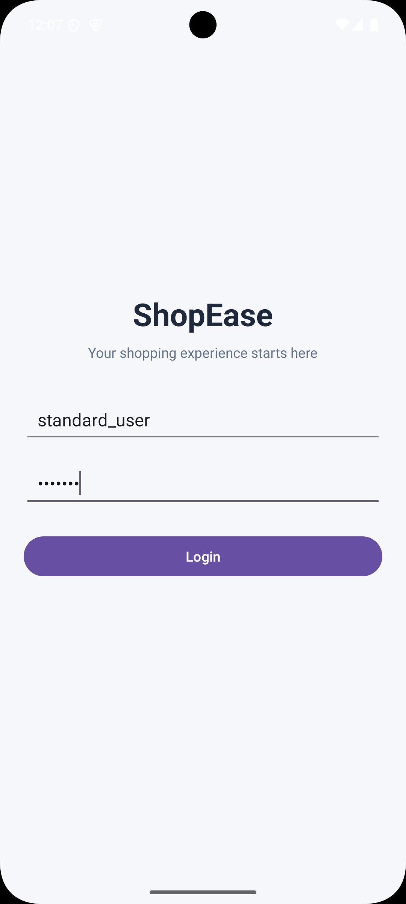
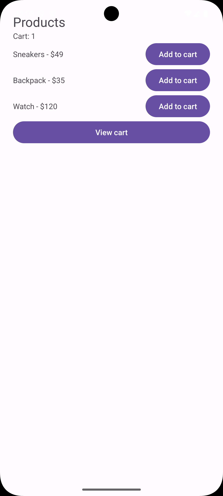
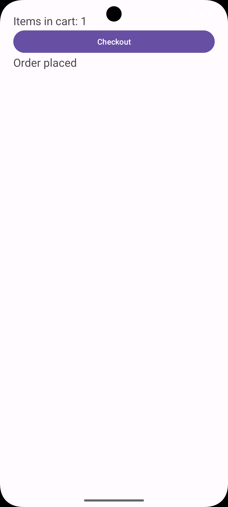

# ShopEase – Android Shopping Application

A demo Android shopping application developed using **Java and XML layouts** in Android Studio.

ShopEase demonstrates a basic e-commerce workflow, including user login, product browsing, shopping cart management, and a demo checkout process.

## Features

- **User Login** – Validate user credentials.
- **Product Listing** – Browse available shopping products.
- **Shopping Cart** – Add products and track cart quantities.
- **Cart Management** – View selected products.
- **Checkout** – Complete a demo shopping order.
- **Input Validation** – Handle invalid login credentials and empty-cart checkout.

## Technology Stack

| Technology | Purpose |
|---|---|
| Java | Android application development |
| XML | User interface layouts |
| Android Studio | Development environment |
| Gradle | Build automation |
| Android SDK | Android platform and development tools |
| Git & GitHub | Version control and repository hosting |

## Project Structure

```text
ShopEase/
├── .github/
├── app/
│   ├── src/
│   │   ├── main/
│   │   │   ├── java/com/shopease/app/
│   │   │   │   ├── MainActivity.java
│   │   │   │   ├── ProductListActivity.java
│   │   │   │   ├── CartActivity.java
│   │   │   │   └── Cart.java
│   │   │   ├── res/
│   │   │   │   └── layout/
│   │   │   └── AndroidManifest.xml
│   │   ├── androidTest/
│   │   └── test/
│   └── build.gradle.kts
├── gradle/
├── screenshots/
│   ├── login-screen.png
│   ├── product-screen.png
│   └── cart-screen.png
├── build.gradle.kts
├── settings.gradle.kts
├── gradlew
├── gradlew.bat
└── README.md
```

*Note: The structure above is a simplified overview. Your actual project may contain additional files and folders.*

## Getting Started

### Prerequisites

Before running the application, make sure you have:

- Android Studio
- JDK 21
- Android SDK
- Android emulator or physical Android device

### Installation

1. Clone the repository:

```bash
git clone https://github.com/cjdaprogrammer/ShopEase-Android-App.git
```

2. Open the cloned project in Android Studio.
3. Allow Gradle to synchronize the project.
4. Start an Android emulator or connect an Android device.
5. Run the application using Android Studio.

## Build APK

To build the debug APK using Windows PowerShell:

```powershell
.\gradlew assembleDebug
```

After a successful build, the APK will be generated at:

```text
app/build/outputs/apk/debug/app-debug.apk
```

## Demo Login Credentials

| Field | Value |
|---|---|
| Username | `standard_user` |
| Password | `shop123` |

**Note:** These are demonstration credentials for the current application implementation. They are not intended for production authentication.

## Automated Testing

The ShopEase application is supported by a separate mobile test automation project.

The automation framework uses:

- Appium
- Java
- TestNG
- Maven
- Cucumber
- UiAutomator2
- Allure Reports
- Jira
- Zephyr Scale
- GitHub Actions

The automation project contains mobile test scripts, execution reports, test evidence, and CI workflow configuration.

**Mobile QA Repository:**  
https://github.com/cjdaprogrammer/shopease-mobile-qa

## Application Screenshots

### Login Screen



### Product Listing Screen



### Shopping Cart Screen



## Continuous Integration

GitHub Actions is configured to automatically build the Android application when changes are pushed to the repository or a pull request is created.

The workflow:

1. Checks out the source code.
2. Sets up Java.
3. Builds the Android application using Gradle.
4. Uploads the generated debug APK as a workflow artifact.

## Future Improvements

- Improve application UI and user experience.
- Add product search and filtering.
- Add product details and quantity management.
- Implement persistent cart storage.
- Introduce secure authentication.
- Improve checkout and order history.
- Expand automated testing coverage.

## Repository

**GitHub Repository:**  
https://github.com/cjdaprogrammer/ShopEase-Android-App

The repository contains the Android application source code, project documentation, screenshots, and build workflow.

---

**Project:** ShopEase – Android Shopping Application  
**Platform:** Android  
**Programming Language:** Java  
**UI Design:** XML  
**Developer:** cjdaprogrammer